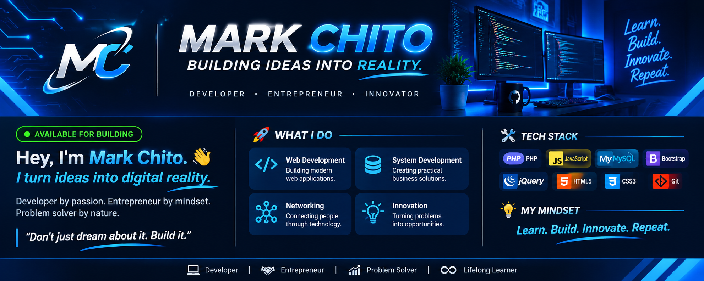

# Hey, I'm Mark Chito 👋

### Developer · Entrepreneur · Problem Solver

**I turn ideas into digital reality.**

Developer by passion. Entrepreneur by mindset. Problem solver by nature.

---

## 🚀 What I Do

| Area | Focus |
|:--|:--|
| 💻 **Web Development** | Building responsive web applications and custom solutions |
| ⚙️ **System Development** | Creating practical business and management systems |
| 🗄️ **Backend & Databases** | Designing application logic, database structures, and integrations |
| 🌐 **Networking** | Working with internet infrastructure and network administration |
| 💡 **Automation** | Improving workflows and solving everyday operational problems |

## 🛠️ Technologies & Tools

- **Languages:** PHP, JavaScript, HTML5, CSS3
- **Frameworks & Libraries:** Bootstrap, jQuery
- **Databases:** MySQL, MariaDB
- **Tools:** Git, GitHub, XAMPP
- **Other Interests:** MikroTik, networking, system architecture

## 💭 My Mindset

> Don't just dream about it. Build it.

I enjoy learning how things work, experimenting with new ideas, and turning real-world problems into useful digital solutions. I believe good software comes from curiosity, consistency, and the willingness to keep improving.

### LEARN · BUILD · INNOVATE · REPEAT

